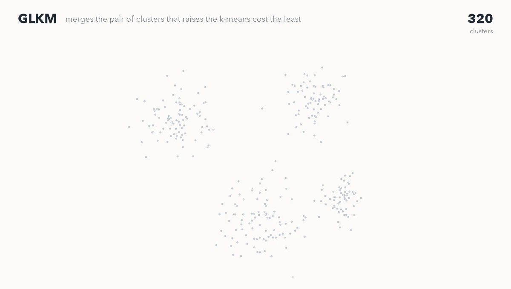
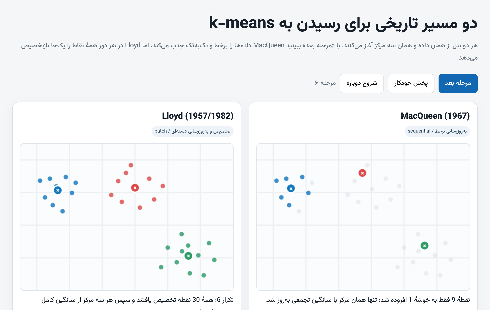
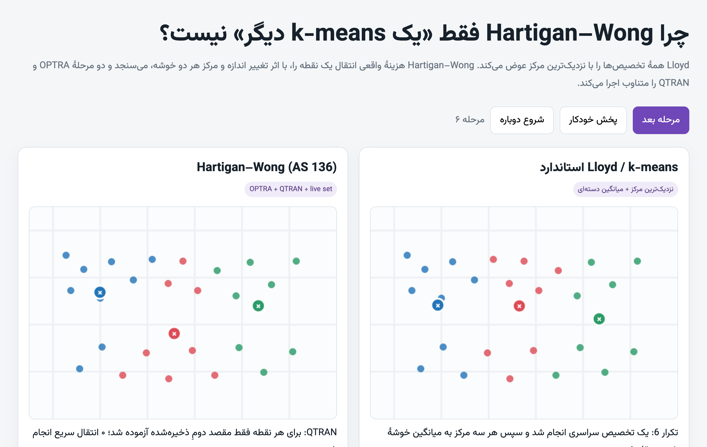
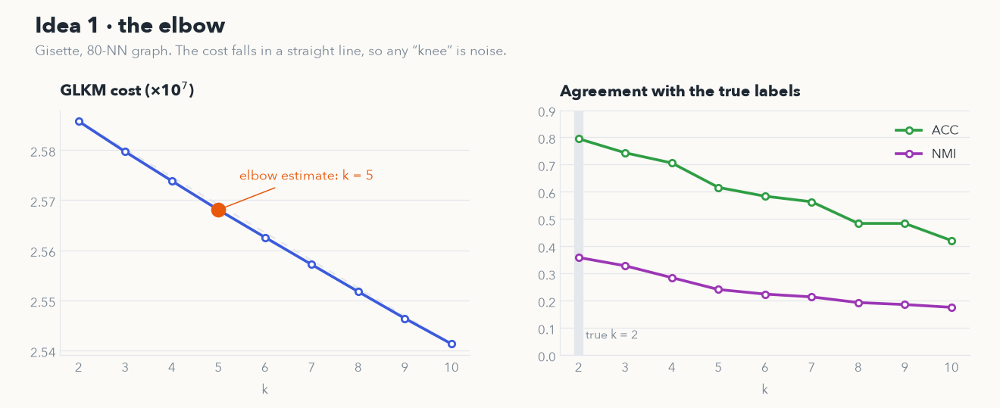
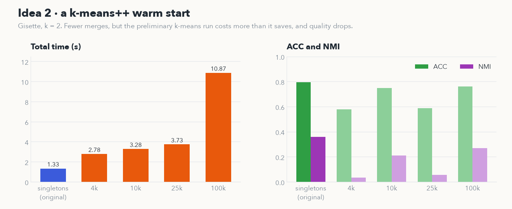

<div align="center">

# GLKM Research

**Studying a new greedy k-means, and testing two ways to improve it.**<br>
Bachelor project in computer science &nbsp;·&nbsp; University of Isfahan &nbsp;·&nbsp; 2026

<br>



<sub>Real GLKM output: the code in this repository, run once for every cluster count from 320 down to 4.</sub>

</div>

<br>

In 2026, Yuan, Zhao, Pei and Nie published **GLKM**, a greedy method for k-means. It treats every point as its own cluster, then keeps merging the pair whose merge raises the k-means cost the least, until k clusters remain. My bachelor project, supervised by Dr. Najmeh Hosseini Monjezi, set out to understand it from the ground up and then to improve it.

Neither of my two ideas improved it. This repository is the record of how I tested them and why they fell short.

## The question

GLKM asks the user for k, and it begins from n singletons, so it performs almost n merges. Each of those suggested an experiment:

1. **Can GLKM choose k itself?** Run it over a range of k and read the answer off the elbow of the cost curve.
2. **Can it start closer to the finish?** Build a rough partition of αk clusters with k-means++, then let GLKM merge only from there.

## The path

### 1 · Back to 1957

Before touching GLKM, I read how k-means came to be. The thread runs through Lloyd's quantizer at Bell Labs (1957, published 1982), MacQueen's online updates (1967), Hartigan and Wong's single-point moves (1979), k-means++ seeding (2007), and two methods that search for k, X-means and global k-means. To see the differences rather than just read about them, I made two step-by-step pages that run the algorithms side by side.

<table>
<tr>
<td width="50%"><a href="https://ausdavoud.github.io/GLKM-Research/macqueen-vs-lloyd.html"></a></td>
<td width="50%"><a href="https://ausdavoud.github.io/GLKM-Research/hartigan-wong-vs-lloyd.html"></a></td>
</tr>
<tr>
<td align="center"><sub><a href="https://ausdavoud.github.io/GLKM-Research/macqueen-vs-lloyd.html">MacQueen against Lloyd</a>, live</sub></td>
<td align="center"><sub><a href="https://ausdavoud.github.io/GLKM-Research/hartigan-wong-vs-lloyd.html">Hartigan–Wong against Lloyd</a>, live</sub></td>
</tr>
</table>

### 2 · How GLKM works

The key step is an identity: a cluster's cost can be written using only distances between its own points, with no centroid.

```math
\sum_{x\in S}\lVert x-\mu_S\rVert^2 \;=\; \frac{1}{2|S|}\sum_{x,y\in S}\lVert x-y\rVert^2
```

So the cost of merging two clusters can be updated from cluster statistics alone. To avoid storing all n² distances, GLKM keeps a k-nearest-neighbour graph, uses a single large constant γ for pairs the graph leaves out, and only considers merges between neighbouring clusters.

### 3 · Idea one: let the elbow choose k &nbsp;✗

I added a sweep that runs GLKM for k = 2 … 10 and picks the k farthest from the chord between the two ends of the cost curve.



- **Gisette:** the cost falls in an almost perfect straight line. The chord method still names a winner, k = 5, but that is geometry, not structure: the data has two classes, and both ACC and NMI are best at k = 2.
- **D1:** the cost never moved. The 12-nearest-neighbour graph splits D1 into 186 disconnected pieces, and since GLKM only merges neighbours, it stopped at 186 clusters whatever k was asked for.

### 4 · Idea two: start from a k-means++ partition &nbsp;✗

GLKM's core accepts initial labels in this version, so it can start from m = αk clusters instead of n singletons and make only m − k merges.



The merges did get cheaper, but the preliminary k-means run cost more than it saved, so every warm start was slower overall. The internal cost dipped slightly while agreement with the true labels fell, at its worst from an NMI of 0.358 to 0.033.

### 5 · What it adds up to

No better GLKM yet. What came out of it is two ideas turned into testable claims, with evidence for exactly how each one fails, plus tools to rerun every number above. A few things are clearer now:

- A knee detector needs a curve with a knee. On near-linear costs it should report that there isn't one, not pick a point anyway.
- On D1, the neighbour graph, not the objective, set the limit. Making sure the graph is connected comes before choosing k.
- A warm start pays off only if it costs less than the merges it saves.

## Repository

```
code/      GLKM (C++ with a Cython interface) plus both experiments and their results
thesis/    the report, in Persian: PDF and LaTeX source
docs/      the interactive pages, served by GitHub Pages, and the figures above
```

The history follows the project: the original code, one branch per idea, both merged back.

## Running it

```bash
cd code
uv sync
brew install libomp        # macOS only: GKM is built with OpenMP
(cd GKM && uv run python setup.py build_ext --inplace)
(cd LKM && uv run python setup.py build_ext --inplace)

uv run python sweep_c.py --dataset Gisette --c-values 2:10                      # idea one
uv run python sweep_c.py --dataset Gisette --c-values 2 --kpp-init --compare-raw  # idea two
```

The datasets are not included (Gisette alone is 267 MB); put the `.mat` files in `code/dataset/`. To build the thesis, add XB Niloofar, B Nazanin, Titr, IranNastaliq and Times New Roman to `thesis/Fonts/`, then run `latexmk -xelatex Thesis.tex` in `thesis/`.

## Reading list

| Year | Paper |
| :-- | :-- |
| 1957 | S. P. Lloyd, [Least squares quantization in PCM](https://doi.org/10.1109/TIT.1982.1056489), *IEEE Trans. Information Theory*, 1982 |
| 1967 | J. MacQueen, Some methods for classification and analysis of multivariate observations, *Fifth Berkeley Symposium* |
| 1979 | J. A. Hartigan and M. A. Wong, [Algorithm AS 136: A k-means clustering algorithm](https://doi.org/10.2307/2346830), *Applied Statistics* |
| 2000 | D. Pelleg and A. Moore, X-means: Extending k-means with efficient estimation of the number of clusters, *ICML* |
| 2003 | A. Likas, N. Vlassis and J. J. Verbeek, [The global k-means clustering algorithm](https://doi.org/10.1016/S0031-3203(02)00060-2), *Pattern Recognition* |
| 2007 | D. Arthur and S. Vassilvitskii, k-means++: The advantages of careful seeding, *SODA* |
| 2008 | G. Frahling and C. Sohler, A fast k-means implementation using coresets, *IJCGA* |
| 2020 | D. Choo, C. Grunau, J. Portmann and V. Rozhoň, [k-means++: Few more steps yield constant approximation](https://arxiv.org/abs/2002.07784), *ICML* |
| 2026 | Y. Yuan, L. Zhao, S. Pei and F. Nie, [Efficient greedy optimization method for k-means](https://doi.org/10.1016/j.patcog.2025.112140), *Pattern Recognition* |

## Credits

GLKM and its code are by Yuan Yuan, Lin Zhao, Shenfei Pei and Feiping Nie, released under the BSD 2-Clause License (see [`code/LICENSE`](code/LICENSE)); `FeiPub` and `LKM` are by [Shenfei Pei](https://github.com/ShenfeiPei). The two interactive pages were built with help from ChatGPT, as the thesis notes. The experiments, the thesis and everything else here are mine, supervised by Dr. Najmeh Hosseini Monjezi.
